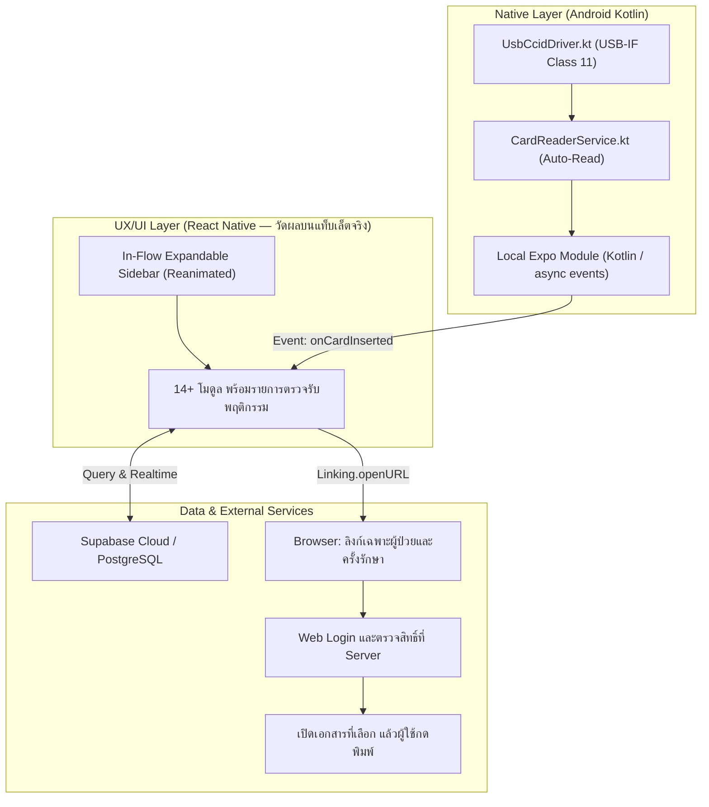
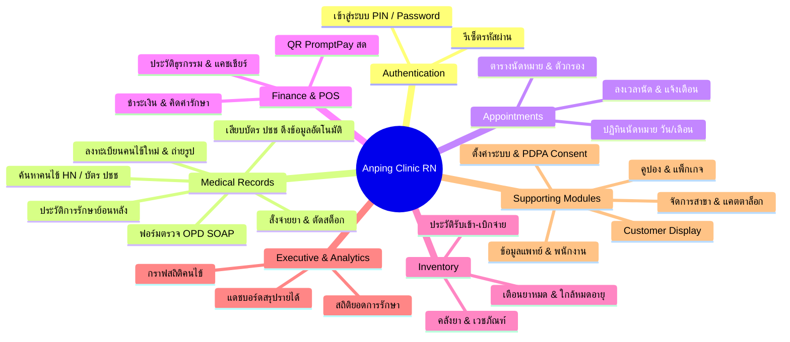
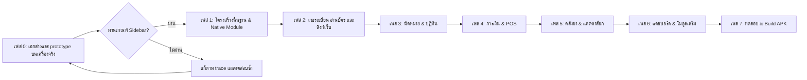

# แผนพัฒนาแอปพลิเคชัน Anping Clinic บน React Native

## เป้าหมายหลัก — Primary goal

ให้ผู้ใช้แท็บเล็ตย่อ–ขยายและลาก Sidebar แบบดันเนื้อหาได้ลื่น อ่านรายการเดิมต่อได้โดยตำแหน่งไม่กระโดด และใช้ฟังก์ชันคลินิกเดิมได้ครบตามรายการตรวจรับ พร้อมอ่านบัตรประชาชนและเปิดเวชระเบียนที่เลือกบนเว็บหลังยืนยันตัวตนก่อนกดพิมพ์เอง

แผนนี้ใช้ React Native สำหรับหน้าจอหลักของ APK โดยไม่ใช้ WebView ในเส้นทางดังกล่าว ส่วนการดูเอกสารและพิมพ์ใช้เว็บแอปผ่าน browser ภายนอก เป้าหมายความครบถ้วนต้องพิสูจน์เป็นรายพฤติกรรม ไม่ถือว่าชื่อหน้าจอครบเท่ากับย้ายระบบสำเร็จ

**สถานะ:** ปรับแผนวันที่ 26 ตุลาคม 2026 ตามผลตรวจ 7 ข้อและข้อกำหนดลิงก์เวชระเบียนของผู้ใช้ ยังไม่ได้สร้าง React Native app หรือเพิ่ม route ใหม่บนเว็บ ตัวเลข performance เป็นเกณฑ์ทดลอง ไม่ใช่ผลวัดหรือคำรับรองว่า ANR จะหายทั้งหมด

**ขอบเขตงาน:** ต้องมีงานทั้ง APK ใหม่และเว็บเดิมเพื่อรองรับลิงก์เฉพาะผู้ป่วย/ครั้งรักษา โดยคง login ก่อนเข้าถึงข้อมูล ไม่ส่งสิทธิ์เข้าถึงข้อมูลมากับ URL ปฏิบัติตาม AGENTS.md: Git ใช้แบบอ่านอย่างเดียว ผู้ใช้เป็นผู้ stage/commit/push และนำขึ้นระบบ

---

## 1. เป้าหมายและขอบเขตของโครงการ (Project Goals & Scope)



### หลักการสำคัญ
1. **ความลื่นไหลที่วัดได้บนอุปกรณ์เป้าหมาย:**
   - Reanimated worklets ช่วยแยกงานแอนิเมชันออกจาก JavaScript thread แต่ React rendering, การคำนวณข้อมูล, native layout และการวาดภาพยังมีต้นทุน ต้องวัด release build ตามเฟส 0 ไม่รับรอง 60–120 FPS จากชื่อ framework
2. **คง UX แบบ In-Flow Sidebar (ไม่ใช้ Overlay):**
   - เมื่อขยายจากความกว้างเริ่มทดลอง 80 เป็น 256 หน่วย layout ของ React Native พื้นที่เนื้อหาต้องหดและถูกดันตามนิ้ว หน่วยนี้ไม่ใช่ physical pixel ของจอ การ animate width ยังทำให้ Yoga คำนวณ layout ทุกเฟรม ต้องจำกัดรายการที่ mount และทดสอบข้อความหลายบรรทัด/กราฟ ไม่ใช้ scale ยืดข้อความหรือภาพถ่ายตารางทับเพื่อให้ผ่านเกณฑ์
3. **เครื่องอ่านบัตรประชาชนแบบ Native ในตัว APK:**
   - นำไดรเวอร์ Kotlin (`UsbCcidDriver.kt` และ `CardReaderService.kt`) มาห่อเป็น Native Module หลังตรวจงาน USB, lock, timeout, cancellation และ lifecycle โดยเฉพาะการถอดอุปกรณ์ระหว่างอ่าน ไม่ถือว่าโค้ดเดิมแก้ ANR ครบแล้ว
4. **การพิมพ์เอกสาร (Print Engine):**
   - ส่งลิงก์ของคนไข้และเอกสารที่เลือกไปเว็บแอปบน browser ภายนอก ถ้าไม่มี web session ให้ login ก่อน แล้วกลับมาเอกสารเดิม ผู้ใช้ตรวจเอกสารและกดพิมพ์เอง ไม่มี auto-print หรือการส่ง token ข้ามไปใน URL ข้อกำหนด `/records/{hn}-{YYMMDD}{visitCode}` อยู่ในหัวข้อ 9
5. **ความครบถ้วนของฟังก์ชันเดิม:**
   - ตรวจรับทั้ง 14+ โมดูลรวมข้อมูล สิทธิ์การใช้งาน การทำงานข้ามอุปกรณ์ และกรณีล้มเหลว ใช้ตาราง parity ในหัวข้อ 8 เป็นฐาน ไม่ใช้คำว่าเหมือนเดิมทั้งหมดแทนผลทดสอบ

---

## 2. สถาปัตยกรรมเทคโนโลยี (Technology Stack)

| ส่วนประกอบ | เทคโนโลยีที่เลือกใช้ | เหตุผลและความคุ้มค่า |
| :--- | :--- | :--- |
| **Framework** | **Expo development build + Prebuild/CNG + React Native New Architecture** | เลือก Expo SDK ที่รองรับ แล้วล็อก RN และ native dependencies ตาม compatibility matrix ในเฟส 0 ไม่ปล่อยเป็น `v0.74+` |
| **Styling Engine** | **NativeWind รุ่นที่เข้ากับชุด dependency หรือ StyleSheet** | เว็บเดิมใช้ Tailwind 4 แต่ NativeWind 4 ใช้ Tailwind 3 ต้องตรวจ utility, rem, grid/table, blur, shadow, font ภาษาไทย และ breakpoint ทีละส่วน ไม่มีเปอร์เซ็นต์ reuse ที่รับรองล่วงหน้า |
| **Icons** | **`lucide-react-native`** | ใช้ชื่อไอคอนอ้างอิงจากเว็บ ตรวจ dependency SVG และหน้าตาบนอุปกรณ์จริง |
| **Sidebar & Gesture** | **Reanimated 4 + Worklets + Gesture Handler รุ่นที่รองรับกัน** | ล็อกเวอร์ชันย่อยตาม Expo/RN; ไม่เริ่มโครงการใหม่ด้วย Reanimated 3 ที่ไม่ได้รับการดูแลแล้ว งาน layout ยังต้องวัด |
| **List Rendering** | **`FlatList` หรือ `@shopify/flash-list`** | เฟส 0 เลือกจาก prototype และ compatibility; จำกัดรายการที่ mount, key คงที่, pagination, ความสูงเปลี่ยนตาม width และ anchor |
| **Navigation** | **React Navigation native stack พร้อม Sidebar shell** | กำหนด Android back, restore state และขอบเขต render; Sidebar เปลี่ยน width โดยไม่ส่ง React state ไปทั้งแอปทุกเฟรม |
| **Database & API** | **`@supabase/supabase-js` + API เดิมผ่าน native adapter** | รักษา schema และกฎธุรกิจ แต่แยก `window`, `localStorage`, IndexedDB, URL แบบ relative และ session lifecycle ออกจาก logic ที่ใช้ร่วมกัน |
| **Local Storage** | **MMKV สำหรับค่าตั้งค่า/แคชขนาดเล็ก; เลือก record store ตามงานจริง** | ออกแบบการย้าย IndexedDB, sync cursor, transaction และ cache wipe; พิจารณา SQLite ถ้าต้อง query/เขียนข้อมูลหลายรายการอย่างเป็นชุด ไม่ใช้ benchmark ของ key-value แทนการออกแบบ offline |
| **Session Storage** | **Native secure storage adapter ตาม auth ที่เลือก** | เก็บ credential ด้วย storage ที่เหมาะสม ตรวจ expiry/revoke/logout และแยก session ของ native app กับ browser ไม่ใช้ MMKV ค่าเริ่มต้นเป็นข้อสรุปเรื่องการป้องกัน token |
| **Smart Card Module** | **Local Expo Module เขียน Kotlin ใน `modules/`** | มี async API/event, IO worker, cancellation และ config plugin สำหรับ service/USB/permission; ใช้ development build ไม่ใช้ Expo Go สำหรับ custom module |

ให้บันทึกชุด Expo SDK/RN/Reanimated/Worklets/Gesture Handler/NativeWind/list library/Gradle/Kotlin ที่เลือกพร้อม lockfile และผล build ในเฟส 0 ถ้าต้องเปลี่ยนเป็น bare React Native ให้แก้แผน native module ทั้งชุดเป็น TurboModule ที่มี typed spec, Codegen, registration และ event lifecycle ไม่ผสมคำว่า TurboModule กับการใช้ `ReactContextBaseJavaModule` อย่างเดียว

---

## 3. สถาปัตยกรรม In-Flow Sidebar แบบ Native (Non-Overlay)

โครงสร้างเริ่มทดลองสำหรับ Sidebar แบบดันเนื้อหา ตัวอย่างนี้แสดงเฉพาะ toggle ยังไม่ใช่ implementation การลากหรือหลักฐาน performance:

```tsx
// โครงทดลอง In-flow: ต้องวัด layout/paint บนแท็บเล็ตจริงก่อนใช้ทั้งระบบ
import type { ReactNode } from 'react';
import { View } from 'react-native';
import Animated, { useSharedValue, useAnimatedStyle, withTiming, Easing } from 'react-native-reanimated';
import { SidebarContent } from './SidebarContent'; // component ที่ต้องพัฒนาในเฟส 0

export function ClinicRootLayout({ children }: { children: ReactNode }) {
  const sidebarWidth = useSharedValue(80); // หน่วย layout ของ React Native

  const toggleSidebar = (expand: boolean) => {
    sidebarWidth.value = withTiming(expand ? 256 : 80, {
      duration: 250,
      easing: Easing.bezier(0.32, 0.72, 0, 1),
    });
  };

  const animatedSidebarStyle = useAnimatedStyle(() => ({
    width: sidebarWidth.value,
  }));

  return (
    <View className="flex-1 flex-row bg-slate-50">
      {/* 1. Sidebar ด้านซ้าย (In-flow layout) */}
      <Animated.View style={animatedSidebarStyle} className="bg-white border-r border-slate-200">
        <SidebarContent width={sidebarWidth} onToggle={toggleSidebar} />
      </Animated.View>

      {/* 2. Content Area ด้านขวา: การเปลี่ยน width ทำให้ต้องจัด layout ใหม่ */}
      <View className="flex-1 overflow-hidden">
        {children}
      </View>
    </View>
  );
}
```

Yoga เป็น layout engine ไม่ใช่คำรับรองว่า animation ทำงานบน GPU ทั้งหมด การ animate `width` ต่างจาก `transform`/`opacity` เพราะต้องคำนวณ layout ทุกเฟรม การคง In-flow จึงเป็นข้อกำหนดที่ต้องพิสูจน์ด้วย workload จริง ([Reanimated performance](https://docs.swmansion.com/react-native-reanimated/docs/guides/performance/))

### จุดเฝ้าระวังของ Sidebar และรายการ

- เพิ่ม `Gesture.Pan()`/`GestureDetector` ตามเอกสารของรุ่นที่ล็อก แยก gesture แนวนอนจากการเลื่อนรายการและปุ่มเมนู รองรับ cancel, กลับทิศ, ปล่อยกลางทาง และ clamp 80–256; ใช้สถานะ gesture เจ้าของเดียว
- `SidebarContent` รับ shared width เพื่อแสดง label ด้วย animated styles; สถานะเปิด/ปิดแบบ React อัปเดตเมื่อจบ gesture ไม่อ่าน `.value` เพื่อ rerender ทั้งแอปทุกเฟรม
- เลือก list virtualizer ในเฟส 0 ไม่สร้างรายการทั้งหมดด้วย `ScrollView` + `.map()` และไม่ mount ทั้ง table/card แล้วซ่อนอีกชุด
- ใช้ ID คงที่สำหรับรายการและการรักษา แยก selection/edit state ออกจาก row ที่ถูก recycle; ตรวจว่าเลื่อนกลับแล้วไม่มี animation เข้าแถวเล่นซ้ำ
- เก็บ anchor เป็น ID กับ offset ในพื้นที่อ่าน ตรวจ header, gap, ความสูงหลายบรรทัด, pagination และการหมุนจอ พร้อมทดสอบรายการเดิมหลังเปลี่ยน width
- แยก chart/data computation ออกจากการลาก ไม่อัปเดต React state จาก `onLayout` วนกลับมาขับ width และไม่เพิ่ม blur/shadow ทั้งหน้าโดยไม่มีผลวัด

---

## 4. รายการหน้าจอที่ต้องพัฒนาและตรวจรับความครบถ้วน



### รายละเอียดการถอดแบบ 14 โมดูลหลัก:

1. **ระบบยืนยันตัวตน (Authentication):**
   - `LoginScreen`: เข้าสู่ระบบด้วยรหัสผ่าน หรือสลับผู้ใช้งานด่วนด้วย PIN ประจำตัว
   - `ResetPasswordScreen`: กู้คืนรหัสผ่านผ่านอีเมล
   - ระบบ session ผ่าน native storage adapter ที่เหมาะกับ credential พร้อม refresh/revoke/logout; browser ใช้ web login ของตนเอง
2. **ระบบเวชระเบียนคนไข้ (Medical Records & Examination):**
   - `MedicalRecords`: หน้าหลักแสดงรายชื่อคนไข้ พร้อมตัวกรองอัจฉริยะ (HN, ชื่อ, เบอร์โทร, วันที่รับรักษา)
   - `PatientModal`: บันทึกข้อมูลส่วนตัวคนไข้, ข้อมูลแพ้ยา, โรคประจำตัว
   - `IdCardScannerModal`: สแกนบัตรหรือเสียบเครื่องอ่าน USB OTG ดึงรูปและข้อมูลกรอกฟอร์มอัตโนมัติ
   - ฟอร์มบันทึกการตรวจรักษา (Chief Complaint, Physical Exam, Diagnosis ICD-10, Treatment, Vital Signs)
   - ประวัติการรักษา (Treatment History Timeline) และลิงก์เว็บเฉพาะผู้ป่วย/ครั้งรักษาตามหัวข้อ 9
3. **ระบบจัดการนัดหมาย (Appointment Manager):**
   - `AppointmentManager`: ตารางรายการนัดหมาย พร้อมปุ่มเลื่อนนัด, ยกเลิก, หรือเข้าตรวจ
   - `CalendarView` & `CalendarDay`: ปฏิทินแสดงนัดหมายรายเดือนและรายวัน
   - สรุปยอดนัดหมายประจำวัน
4. **ระบบการเงินและจุดชำระเงิน (Finance & POS System):**
   - `FinancePage` & `POSSystem`: เลือกคิดค่ายา ค่าหัตถการ ค่าบริการ
   - ระบบสร้าง QR Code PromptPay ตามยอดเงินจริง โดยเลือก encoder/renderer ที่รองรับ React Native ไม่สมมติว่า package `qrcode` ของเว็บใช้งานได้ตรง ๆ
   - `TransactionCard` & `TransactionRow`: รายการบันทึกบิลย้อนหลัง
   - เปิดลิงก์เอกสารที่ระบุบิลใน browser ตรวจ web login/สิทธิ์ แล้วผู้ใช้กดพิมพ์เอง รหัสครั้งรักษาในหัวข้อ 9 ไม่ใช้แทน receipt ID
5. **ระบบคลังยาและเวชภัณฑ์ (Drug Inventory & Stock):**
   - `InventoryManager`: ตรวจสอบสต็อกคงเหลือ, ต้นทุน, ราคาขาย
   - แจ้งเตือนยาใกล้หมดสต็อก และยาใกล้หมดอายุ (Expiry Warning)
   - บันทึกการรับเข้ายาและปรับยอดสต็อก
6. **แดชบอร์ดผู้บริหาร (Executive Dashboard):**
   - `ExecutiveDashboard`: สรุปรายได้คลินิก, กำไร, ยอดการรักษาทั้งหมด, สัดส่วนคนไข้ใหม่/เก่า
   - กราฟแนวโน้มรายได้และผู้ป่วย ทดลอง `react-native-gifted-charts` กับชุดเวอร์ชันที่เลือก และวัดระหว่างลาก Sidebar ก่อนตัดสินใจใช้
   - แถบตัวกรองวันที่แบบ responsive (จัดวาง 2 แถวบนจอแท็บเล็ต ไม่ล้นจอ)
7. **แดชบอร์ดคลินิกทั่วไป (Clinic Dashboard):**
   - `Dashboard` & `StatCard`: แสดงสรุปสถานการณ์ประจำวันแบบ Real-time
8. **ระบบจัดการแพทย์และพนักงาน (Staff & Profile Manager):**
   - `StaffManager`: ข้อมูลแพทย์ พยาบาล เจ้าหน้าที่, ส่วนแบ่งค่าหัตถการ (Commission)
   - `ProfileManager`: แก้ไขข้อมูลส่วนตัวและเปลี่ยนรหัสผ่าน
9. **ระบบจัดการสาขา (Branch Manager):**
   - `BranchManager`: จัดการสาขาคลินิก และสลับสาขาที่กำลังปฏิบัติงาน
10. **ระบบแคตตาล็อกบริการและหัตถการ (Catalog Manager):**
    - `CatalogManager`: ตั้งค่ารายการตรวจ, แพ็กเกจหัตถการ, ค่าบริการทางการแพทย์
11. **ระบบคูปองและแพ็กเกจ (Coupon & Course Manager):**
    - `CouponManager`: ตัดคอร์สการรักษา และบันทึกจำนวนครั้งคงเหลือ
12. **หน้าจอแสดงผลลูกค้า (Customer Display):**
    - `CustomerDisplay`: หน้าจอแสดงรายการและยอดเงินชำระสำหรับหันให้คนไข้ดู แยกทดสอบจอภายนอกจริงกับอุปกรณ์ที่สองผ่านเครือข่าย ไม่ถือว่า BroadcastChannel เดิมใช้ข้าม native app/browser ได้
13. **ระบบจัดการจอโฆษณา (Display Ads Manager):**
    - `DisplayAdsManager`: เล่นวิดีโอหรือสไลด์โฆษณาของคลินิก
14. **การตั้งค่าระบบและ PDPA (Settings & Consent):**
    - `SettingsManager`: ข้อมูลคลินิก, ข้อมูลผู้เสียภาษี, ตั้งค่าอัตโนมัติ
    - `PdpaConsentForm`: ฟอร์มยินยอมข้อมูลส่วนบุคคลพร้อมช่องเซ็นชื่อดิจิทัล

---

## 5. ลำดับขั้นตอนการพัฒนา (Phased Implementation Roadmap)

แต่ละเฟสต้องมีผลตรวจรับก่อนขยายงาน กรอบเดิม 7 สัปดาห์เป็นเพียงประมาณการเบื้องต้น ให้ประเมิน effort ใหม่หลังเฟส 0 จากจำนวนพฤติกรรมที่ต้องย้าย อุปกรณ์ทดสอบ และ dependency ที่เลือก ไม่ใช้กำหนดส่งเป็นเหตุให้ข้ามการตรวจ performance หรือข้อมูล



### เฟส 0: ตรวจเอกสารและพิสูจน์ Sidebar บนเครื่องจริง

**ความเชื่อมโยงกับเป้าหมายหลัก:** พิสูจน์ว่า Native In-flow แก้อาการที่ผู้ใช้เจอได้ก่อนลงทุนย้ายทุกโมดูล

**งานที่ต้องทำ**

1. อ่าน AGENTS.md, แผนแก้ Sidebar เดิม, รายงานวิดีโอ, `src/App.jsx`, `src/hooks/useVirtualRows.js`, `ExecutiveDashboard.jsx` และ native card service ระบุสิ่งที่รู้จากคลิปแยกจากสมมติฐาน: ภาพบางกลุ่มหายบนแดชบอร์ดและมี ANR ยังไม่พิสูจน์ว่าเป็นสาเหตุเดียวกัน
2. เปิดเอกสารปัจจุบันของ Expo/RN/Reanimated/Worklets/Gesture Handler/list library และบันทึก compatibility matrix ของชุดที่จะติดตั้ง รวมถึง API ของ local native module ไม่คัดตัวอย่างจากคนละ major
3. สร้าง prototype ในโครงการแยก โดยคง Sidebar แบบ in-flow ที่ดันเนื้อหาตามที่ผู้ใช้ต้องการ ไม่เปลี่ยนเป็น overlay ใช้ข้อมูลสมมติ 20, 200 และ 1,000 รายการ ข้อความยาว/หลายบรรทัด แถวสูงต่างกัน และแดชบอร์ดกราฟ/ตารางที่ใกล้เคียงหน้าจริง เปรียบเทียบ table/card, sticky header และการเลื่อนแนวนอน
4. จำกัดการพิสูจน์ไว้ที่ 3 หน้าซึ่งมีปัญหา/ภาระหนักที่สุด: (ก) เวชระเบียน ทดสอบ 200 และ 1,000 แถว รวมค้นหา/กรอง/เลื่อนและเปลี่ยนความกว้าง (ข) นัดหมาย ใช้ชุดข้อมูลจำนวนมากและทดสอบปฏิทิน/รายการขณะลาก Sidebar (ค) บอร์ดผู้บริหาร ใส่กราฟ ตาราง ตัวกรอง และอัตรา animation/re-render ให้ใกล้งานจริงที่สุด เพราะเป็น workload หนักสุด ส่วนการเงินยังไม่ทำเป็นหน้าที่ 4 ใน prototype รอบแรก ให้ใช้เวชระเบียนเป็นตัวแทน workload รายการ/ตารางที่ใกล้เคียง แล้วค่อยทดสอบหน้าการเงินจริงหากผลหรือโครงสร้างต่างจากที่คาด
5. สร้างและทดสอบ **release build** บนแท็บเล็ตเครื่องเดิม เปรียบเทียบเว็บใน browser, APK WebView เดิม และ RN prototype ภายใต้เครื่อง/ข้อมูล/viewport/refresh rate/เงื่อนไขความร้อนเดียวกัน บันทึกรุ่นเครื่อง Android, WebView/Chrome, build/data และภาวะเครื่อง ห้ามใช้ desktop หรือ debug FPS แทนผลเครื่องจริง
6. ต่อ workload แต่ละหน้า กดเปิด–ปิดอย่างน้อย 20 รอบ ลากกลับไปมา 10 วินาที ปล่อยกลางทาง/สวนทิศ และเลื่อนรายการระหว่างย่อ–ขยาย ที่ต้น/กลาง/ท้าย ทำอย่างน้อย 3 รอบ เก็บ native frame trace และข้อมูล JS/UI thread แยกกัน พร้อมวัด frame time, เฟรมหลุด, ภาพ/กราฟหาย และ ANR
7. ทดสอบอ่านบัตรประชาชนระหว่างลากและระหว่าง Sidebar เคลื่อนไหว โดยใช้บัตร/ข้อมูลทดสอบ ไม่ใช้ข้อมูลผู้ป่วยจริง จับเวลาและตรวจว่า gesture ไม่ค้าง, UI ไม่หยุด, ผลอ่านไม่สูญหาย/ซ้ำ และไม่มี ANR; การทดลองนี้เป็นการตรวจการทำงานร่วมกัน ไม่ใช่การทำ USB integration เต็มรูปแบบก่อนเฟส 1
8. ตรวจ ANR log/Perfetto และเส้นทาง USB แบบอ่านอย่างเดียวในขั้นวิเคราะห์; ก่อนนำ service มาใช้จริงให้แก้ตามเฟส 1 แล้วทำการทดลองร่วมกับ Sidebar ซ้ำ

**API ที่ใช้เป็นฐาน — อ่านเอกสารก่อนคัดรูปแบบ**

| API / รูปแบบ | ใช้ทำอะไร | แหล่งอ้างอิง |
| --- | --- | --- |
| `useSharedValue`, `useAnimatedStyle`, `withTiming`, `cancelAnimation` | ขับ width และ interrupt animation ตามเวอร์ชันที่ล็อก | [Reanimated](https://docs.swmansion.com/react-native-reanimated/docs/fundamentals/getting-started/) |
| `Gesture.Pan()`, `GestureDetector` | ลากตามนิ้วและจัดความสัมพันธ์กับ scroll; ตัวอย่าง API 2.x ต้องตรวจว่ารุ่นที่ล็อกยังรองรับก่อนคัด | [Gesture Handler Pan](https://docs.swmansion.com/react-native-gesture-handler/docs/2.x/gestures/pan-gesture/) |
| `FlatList` / FlashList | สร้างเฉพาะรายการใกล้จอ ต้องเลือกก่อนกำหนด props | [FlatList](https://reactnative.dev/docs/flatlist), [FlashList](https://shopify.github.io/flash-list/docs/) |
| Local Expo Module + config plugin | Kotlin module และ native configuration ที่สร้างซ้ำได้ | [Expo custom native code](https://docs.expo.dev/workflow/customizing/), [CNG](https://docs.expo.dev/workflow/continuous-native-generation/) |
| `Linking.openURL(url)` | ขอให้ Android เปิดเว็บภายนอก; ต้องรับกรณีเปิดไม่สำเร็จ | [React Native Linking](https://reactnative.dev/docs/linking) |
| `matchPath('/records/:recordKey', pathname)` | จับ record key ในเว็บเดิมก่อนเลือก tab | [React Router v7 matchPath](https://reactrouter.com/7.18.4/api/utils/matchPath) |
| `useNavigate()`, `navigate(path, { replace: true })` | ใช้เมื่อจำเป็นต้องคืน URL หลัง login; ต้อง validate ปลายทางเอง | [React Router v7 useNavigate](https://reactrouter.com/7.18.4/api/hooks/useNavigate) |

**เกณฑ์ตรวจรับเบื้องต้น**

- [ ] รายงาน frame time p50/p95/p99, สัดส่วนเฟรมเกิน frame budget และเกิน 33.3/100ms, จำนวน row ที่ mount, memory และ ANR พร้อม trace ที่ไม่เก็บข้อมูลคนไข้จริง
- [ ] ระบุโหมดรีเฟรชจริง: budget ประมาณ 16.7ms ที่ 60Hz และ 8.3ms ที่ 120Hz ถ้าตั้งเป้า 120 ต้องพิสูจน์แยก ไม่ถือว่าจอรองรับเท่ากับแอปรันได้
- [ ] สำหรับเป้าหมายเริ่มต้น 60Hz: p95 ไม่เกิน 20ms, เฟรมเกิน 33.3ms ไม่เกิน 5%, ไม่มีเฟรมเกิน 100ms ที่เกิดซ้ำจาก Sidebar และไม่พบภาพหายหรือ ANR ในชุดทดสอบ ทั้งหมดเป็นเกณฑ์เสนอ ไม่ใช่ผลที่ผ่านแล้ว
- [ ] ผล release build ผ่านแยกครบทั้งเวชระเบียน 200/1,000 แถว, นัดหมาย และบอร์ดผู้บริหารที่มีกราฟ+ตาราง; ระบุผลเปรียบเทียบกับ browser/WebView เดิมบนเครื่องเดียวกัน และแสดงว่า Sidebar แบบดันเนื้อหาให้ผลดีขึ้นจริง ไม่ใช่เพียงผ่านตัวเลขเดี่ยว
- [ ] อ่านบัตรระหว่างลาก Sidebar ผ่านโดยไม่เกิด UI ค้าง/ข้อมูลทดสอบสูญหาย/ANR และไม่เก็บเลขบัตรหรือข้อมูลระบุตัวบุคคลลง trace/log
- [ ] Anchor ID คงเดิมและ offset ต่างไม่เกิน 4 หน่วย layout หลังนิ่ง เมื่อแถวยังอยู่และไม่ชนขอบเลื่อน; ไม่มีช่องว่าง/รายการผิด ID
- [ ] จำนวน row ที่ mount มีขอบเขตตาม viewport/overscan ไม่โตตามข้อมูลทั้งหมด และยังเลือก/แก้ไขรายการได้ถูกต้อง
- [ ] ถ้าไม่ผ่าน หรือผลไม่ดีขึ้นอย่างมีนัยใช้งานเมื่อเทียบกับ browser/WebView เดิม ให้หยุดขยายการย้ายโมดูล แก้ตาม trace และทดสอบเฟส 0 ซ้ำ; หากยังไม่ผ่านหลังแก้ ให้ทบทวนแนวทาง/ขอบเขตโครงการก่อนลงทุนย้ายหน้าที่เหลือ ระบุข้อจำกัดเครื่องจริงให้ชัด

**จุดเฝ้าระวัง:** ไม่ใช้หน้าว่างพิสูจน์ความลื่น, ไม่ใช้ debug FPS เป็นผล release, ไม่ยืนยันว่า Yoga/Worklet ทำให้ width ไม่มีต้นทุน และไม่เปลี่ยน Sidebar เป็น overlay เพื่อหลบข้อกำหนด

### เฟส 1: โครงสร้าง Native, ข้อมูล และเครื่องอ่านบัตร

**ความเชื่อมโยงกับเป้าหมายหลัก:** ให้ Sidebar ที่ผ่านการทดลองทำงานร่วมกับข้อมูลและอุปกรณ์ได้โดยไม่ดึงงานหนักกลับมาบล็อกหน้าจอ

**งาน:** ตั้ง Expo development build ด้วยชุดเวอร์ชันจากเฟส 0; ห่อ driver/service เป็น local module ใน `modules/` ตามตัวอย่าง Expo พร้อม config plugin สำหรับ manifest/service/USB; ออกแบบ async read, event, subscription cleanup, timeout, cancel และสถานะเครื่องอ่าน; แยก adapter สำหรับ API/storage/session/เครือข่ายและ lifecycle foreground/background

ตรวจ `CardReaderService.kt` โดยเฉพาะ `onReceive → detachDevice → synchronized(readLock)` กับ `readCard` ที่ถือ lock ระหว่าง USB IO แก้การรอ lock บน main thread รวมถึง close/init/hot-plug แล้วจึงนำเข้าระบบใหม่ ไม่เปลี่ยน sync USB call เป็น TurboModule แบบ synchronous

**อ้างอิง:** [Expo custom native code](https://docs.expo.dev/workflow/customizing/), [CNG](https://docs.expo.dev/workflow/continuous-native-generation/), [Android broadcasts](https://developer.android.com/develop/background-work/background-tasks/broadcasts), `CardReaderService.kt`, `UsbCcidDriver.kt`, `src/lib/offlineStore.js`, `src/lib/supabase.js`

**ตรวจรับ:** [ ] สร้าง native project ใหม่จาก config แล้ว build ได้; [ ] ปฏิเสธ permission/ถอด USB ระหว่างอ่าน/timeout/เสียบซ้ำ/กลับจาก background แล้วไม่บล็อก main thread; [ ] ไม่มี event ซ้ำหรือข้อมูลบัตรเก่าทับฟอร์มใหม่; [ ] logout ล้างข้อมูลเฉพาะผู้ใช้ตามนโยบาย; [ ] มีผลทดสอบ Sidebar ร่วมกับเครื่องอ่าน

**จุดเฝ้าระวัง:** ไม่เก็บต้นฉบับ Kotlin ที่แก้เองไว้เฉพาะ generated `android/`; ไม่ถือว่าอ่านบน IO แล้วทุก caller ปลอดจาก ANR; ไม่แทนระบบ offline เดิมด้วย key-value store โดยข้ามพฤติกรรม sync

### เฟส 2: เวชระเบียน ประวัติการรักษา และลิงก์เว็บหลัง login

**ความเชื่อมโยงกับเป้าหมายหลัก:** ผู้ใช้ค้นหาและเปิดเวชระเบียนถูกคน/ถูกครั้งได้ ทั้งใน native app และเมื่อต้องดูเอกสารบนเว็บ

**งาน:** พัฒนารายการแบบ virtualized, Search/filter, ฟอร์มตรวจและประวัติเดิม; เชื่อมข้อมูลบัตร; เพิ่ม route `/records/:recordKey` ฝั่งเว็บ, ตัวสร้างลิงก์ฝั่ง native, server resolver, stable visit-code mapping และ login-return ตามหัวข้อ 9; ใช้ HTML generator เดิมเฉพาะส่วนที่สร้างเอกสาร โดยตัดเส้นทาง auto-print ออกจาก flow ใหม่นี้

เก็บเวลาการอ่านข้อมูลกับรูปภาพแยกกัน เป้าหมายข้อมูลพร้อมรูปต่ำกว่า 2 วินาทีต้องวัดกับ reader/card จริง; หากช้ากว่าให้แสดงสถานะและยกเลิกได้ ไม่ใช้เวลาเป้าหมายบังคับให้ UI รอแบบ synchronous

**อ้างอิง:** `src/pages/MedicalRecords.jsx`, `src/global/helpers.jsx` (`globalGenerateRecordHtml`, `globalGenerateOpdHtml`), `src/App.jsx` ส่วน routing/login/print, `api/db.js`, `vercel.json`, [React Router matchPath](https://reactrouter.com/7.18.4/api/utils/matchPath), [Linking](https://reactnative.dev/docs/linking)

**ตรวจรับ:** [ ] รายการ/ฟอร์ม/ID/anchor ถูกต้อง; [ ] อ่านบัตรสำเร็จ/ล้มเหลวไม่ทำฟอร์มหาย; [ ] URL `26102600/26102601/26102602/26102603` เปิดถูกเอกสารหลัง login; [ ] ไม่เรียกพิมพ์เอง; [ ] refresh/bookmark/หลายแท็บ/เซสชันหมดอายุผ่าน; [ ] สิทธิ์และกรณีไม่พบรายการผ่าน checklist หัวข้อ 9 ก่อนใช้งานจริง

**จุดเฝ้าระวัง:** ไม่เปิดเพียง `/records`, ไม่หา treatment ด้วยลำดับใน array หรือวันที่อย่างเดียว, ไม่ fallback เป็นครั้งล่าสุดเมื่อ URL ไม่ตรง และไม่เปิดเผยข้อมูลก่อน server ตรวจสิทธิ์

### เฟส 3: นัดหมายและปฏิทิน

**ความเชื่อมโยงกับเป้าหมายหลัก:** รักษางานนัดหมายเดิมขณะเปลี่ยน Sidebar หรือหมุนจอโดยไม่ข้าม/ซ้ำข้อมูล

**งาน:** ย้ายมุมมองรายเดือน/รายวันและรายการนัดพร้อม pagination; สร้าง/แก้/เลื่อน/เปลี่ยนสถานะตามกฎเดิม; ตรวจช่องทางแจ้งเตือนที่มีจริงก่อนนำมาใช้ ไม่เพิ่ม SMS เป็นฟีเจอร์ใหม่เพียงเพราะเคยอยู่ในรายการแผน

**อ้างอิง:** `src/pages/AppointmentManager.jsx`, API เดิม และเอกสาร calendar/list library รุ่นที่เลือกในเฟส 0

**ตรวจรับ:** [ ] วันที่และ timezone ถูกต้อง; [ ] รายการครบและไม่มี request ซ้ำ; [ ] ลาก Sidebar/เลื่อน/หมุนจอแล้วยังอยู่รายการเดิม; [ ] notification และสิทธิ์สาขาตรงกับพฤติกรรมเดิม

**จุดเฝ้าระวัง:** ไม่ใช้ virtualization แทน pagination และไม่ทิ้ง state ของนัดที่กำลังแก้เมื่อ row ออกจากจอ

### เฟส 4: การเงิน POS และเอกสารทางการเงิน

**ความเชื่อมโยงกับเป้าหมายหลัก:** คิดเงินและดูเอกสารได้ถูกต้องโดย UI ยังตอบสนองขณะมีข้อมูลและงาน native ร่วมกัน

**งาน:** ย้ายการคิดเงิน/ส่วนลด/ภาษี/คอร์ส/ชำระเงินและ QR ตามกฎเดิม; กำหนดลิงก์บิลด้วย receipt ID แยกจาก visit code; เปิด browser ให้ login ตรวจสิทธิ์และแสดงเอกสารก่อนผู้ใช้กดพิมพ์ตามหลักเดียวกับหัวข้อ 9

**อ้างอิง:** `src/pages/POSSystem.jsx`, `src/pages/FinancePage.jsx`, `src/global/helpers.jsx`, `api/db.js`, [React Native Linking](https://reactnative.dev/docs/linking)

**ตรวจรับ:** [ ] ยอดรวม/ภาษี/QR/เอกสารตรงข้อมูลเดิม; [ ] กดซ้ำ/retry/network interruption ไม่บันทึกซ้ำ; [ ] เปลี่ยนสาขาไม่ใช้ข้อมูลเก่า; [ ] login ก่อนเปิดเอกสารและไม่มี auto-print; [ ] Sidebar ผ่าน workload หน้าการเงิน

**จุดเฝ้าระวัง:** ไม่ใส่ session token หรือ payload คนไข้ใน URL, ไม่สรุปว่าระบบ browser จะเปิด Chrome เสมอ และไม่ใช้เลข `00/01` แทนรหัสบิล

### เฟส 5: คลังยา แคตตาล็อก และคอร์ส

**ความเชื่อมโยงกับเป้าหมายหลัก:** คงจำนวนสินค้าและสิทธิ์คอร์สถูกต้องระหว่างใช้งานหลายหน้าหรือกลับมาออนไลน์

**งาน:** ย้าย stock/batch/expiry, รับเข้า/เบิกจ่าย, แคตตาล็อกและการตัดคอร์ส; ระบุ consistency และ retry ของการเปลี่ยนข้อมูลหลายชุดตามพฤติกรรมเดิม

**อ้างอิง:** `InventoryManager`, `CatalogManager`, `CouponManager` และ data/API layer เดิม; ตรวจ caller ที่ใช้งานจริงก่อนคัด logic

**ตรวจรับ:** [ ] สต็อกและจำนวนคอร์สตรงกันหลังทำรายการ; [ ] ข้อมูลลบ/แก้/realtime/reconnect ถูกต้อง; [ ] retry ไม่ตัดซ้ำ; [ ] list และ Sidebar ผ่านเกณฑ์เฟส 0

**จุดเฝ้าระวัง:** ไม่ประกาศว่า offline เขียนข้อมูลได้ หากระบบเดิมรองรับเพียงอ่าน cache; ต้องกำหนด conflict/retry ก่อนเพิ่ม offline writes

### เฟส 6: แดชบอร์ดและโมดูลสนับสนุน

**ความเชื่อมโยงกับเป้าหมายหลัก:** ตรวจหน้ากราฟซึ่งมีภาพหายในคลิป และรักษาการทำงานข้ามหน้าจอ/ผู้ใช้ที่รายการโมดูลอย่างเดียวไม่ครอบคลุม

**งาน:** ขยาย prototype แดชบอร์ดเป็นหน้าจริง; ย้ายพนักงาน/สิทธิ์/สาขา/รายงาน/ตั้งค่า/PDPA; ทดสอบ customer display และสื่อโฆษณาโดยแยกจอภายนอกกับอุปกรณ์ผ่านเครือข่าย กำหนดตัวแทน BroadcastChannel และ media cache ตามหัวข้อ 8

**อ้างอิง:** `ExecutiveDashboard.jsx`, `Dashboard.jsx`, `src/lib/customerDisplaySync.js`, `src/lib/customerDisplayMediaCache.js` และเอกสาร chart/display/media library ที่เลือก

**ตรวจรับ:** [ ] กราฟ/ตัวเลข/ตัวกรองตรงกันและไม่หายเมื่อเปลี่ยน width; [ ] จอลูกค้าแสดง station/ยอดที่ถูกต้อง; [ ] สลับแอป/ตัดเครือข่าย/หมุนจอแล้วกู้ state ได้; [ ] สิทธิ์และข้อมูลยินยอมตรงระบบเดิม

**จุดเฝ้าระวัง:** ไม่ถือว่า BroadcastChannel ใช้ข้าม RN กับ browser ได้; ไม่เท่ากันระหว่างการ mirror จอกับการแสดงคนละเนื้อหาบนสองจอ และไม่บังคับ UI reuse โดยข้ามข้อจำกัด native styling

### เฟส 7: ตรวจรับรวม ทดลองใช้งาน และเตรียม Release APK

**ความเชื่อมโยงกับเป้าหมายหลัก:** ส่งมอบเมื่อฟังก์ชันหลักและความลื่นพิสูจน์แล้ว พร้อมเส้นทางกลับไปใช้งานเดิมหากพบปัญหา

**งาน:** ตรวจ implementation กับเอกสารของเวอร์ชันที่ล็อก; รันทดสอบตาม behavior matrix หัวข้อ 8 และ URL matrix หัวข้อ 9; stress test บนเครื่องจริงอย่างน้อย 30 นาที รวมอ่านบัตร/เลื่อน/เปิดปิด Sidebar/สลับ browser; ตรวจ memory trend, frame trace และ ANR; build release/signing ตามโครงการใหม่ และทดสอบ web build ของ route ใหม่แยกกัน

จัด pilot APK application ID แยกจากแอปเดิมเพื่อเทียบคู่กัน ก่อนแทน APK เดิมต้องวางแผน package/signature/versionCode, schema ที่ใช้ร่วมกัน, session/cache และ rollback โดยไม่ลบข้อมูลผู้ป่วย ย้ายเฉพาะหลังผ่านเกณฑ์และผู้ใช้เป็นผู้จัดการการนำขึ้นระบบ

**อ้างอิง:** [RN performance](https://reactnative.dev/docs/performance), [Reanimated performance](https://docs.swmansion.com/react-native-reanimated/docs/guides/performance/), [Android ANR](https://developer.android.com/topic/performance/anrs/diagnose-and-fix-anrs), AGENTS.md และคำสั่งจริงใน package/build config ของแต่ละโครงการ

**ตรวจรับ:** [ ] build/type/lint/tests ที่มีจริงผ่านและรายงานข้อผิดพลาดเดิมแยก; [ ] performance ผ่านเฟส 0 ทุกหน้าที่เกี่ยวข้อง; [ ] ไม่พบ ANR/ภาพหายในชุดทดสอบ; [ ] ทุกพฤติกรรมที่จำเป็นมีหลักฐาน parity; [ ] deep link/login/manual print ผ่าน; [ ] pilot/rollback ผ่าน; [ ] สรุปข้อจำกัดที่ยังเหลือ ไม่รับรองว่าปราศจากปัญหาทุกอุปกรณ์

**จุดเฝ้าระวัง:** ไม่ประกาศเสร็จจาก build ผ่านอย่างเดียว, ไม่ใช้ desktop แทน tablet, ไม่เก็บข้อมูลจริงใน artifact ทดสอบ และไม่รัน git add/commit/push

---

## 6. แนวทางการจัดโครงสร้างโฟลเดอร์ของโปรเจกต์ใหม่

```text
anping-tablet-app/
├── android/                        # ผลจาก Prebuild; ไม่ใช่ที่เก็บต้นฉบับ custom module
├── modules/anping-smart-card/      # Local Expo Module; เก็บ Kotlin/resources/dependencies ที่นี่
│   ├── android/src/main/java/.../
│   │   ├── UsbCcidDriver.kt        # ไดรเวอร์ที่ตรวจ thread/lock แล้ว
│   │   ├── CardReaderService.kt    # IO, cancellation, lifecycle และ event cleanup
│   │   └── AnpingSmartCardModule.kt
│   └── src/                       # Typed native API/events ตาม Expo Modules รุ่นที่เลือก
├── plugins/                       # Config plugin สำหรับ service/USB/permissions
├── app.config.ts                  # Native configuration ที่สร้างซ้ำได้
├── src/
│   ├── api/                        # Supabase/API clients และ auth adapter
│   ├── storage/                    # Native record cache, settings, secure-session adapters
│   ├── links/                      # สร้าง/validate patient-record URL จาก identity ที่ server ยืนยัน
│   ├── components/                 # คอมโพเนนต์ UI พื้นฐาน (Buttons, Inputs, Cards)
│   │   ├── InFlowSidebar.tsx       # Sidebar ขยาย-ยุบแบบ In-flow (Reanimated)
│   │   ├── TopNavBar.tsx           # บาร์บนพร้อมสถานะเครื่องอ่านบัตร
│   │   └── PromptPayQR.tsx
│   ├── hooks/                      # Custom hooks (useSmartCard, useAppointments)
│   ├── navigation/                 # ระบบการเปลี่ยนหน้า (React Navigation)
│   ├── screens/                    # หน้าจอทั้ง 14 โมดูล
│   │   ├── medical/                # เวชระเบียน & ตรวจรักษา
│   │   ├── appointment/            # นัดหมาย & ปฏิทิน
│   │   ├── cashier/                # การเงิน & คิดเงิน
│   │   ├── inventory/              # คลังยา
│   │   ├── executive/              # แดชบอร์ดผู้บริหาร
│   │   └── settings/               # ตั้งค่า & พนักงาน
│   └── utils/                      # Helper formatters (เงิน, วันที่, บัตร ปชช.)
├── package.json
└── tailwind.config.js              # เฉพาะเมื่อรุ่น NativeWind ที่เลือกใช้ config รูปแบบนี้
```

เว็บเดิมยังอยู่โครงการปัจจุบัน: งาน route/login-return อยู่ใน `src/App.jsx` หรือ router ที่แยกออกมา, งานเลือกผู้ป่วย/ครั้งรักษาใน `src/pages/MedicalRecords.jsx`, งาน resolver/authorization ใน API และส่วนที่ใช้ HTML generator เดิม ต้องทดสอบ rewrite ของ `vercel.json` กับ nested path โดยไม่แก้ config หากของเดิมรองรับแล้ว

---

## 7. ข้อสังเกตและจุดเฝ้าระวังจากผลตรวจ 7 ข้อ

| ข้อ | ประเด็นที่ต้องเฝ้าระวัง | สิ่งที่ต้องทำ/หลักฐานก่อนปิดประเด็น |
| --- | --- | --- |
| 1 | เปลี่ยนเป็น RN ไม่รับประกันว่า width animation ไม่มี frame drop หรือ ANR | ลบคำรับรอง 120 FPS/หายทั้งหมด ใช้ native/JS trace และเกณฑ์เฟส 0; แยกงาน UI thread, layout และ USB |
| 2 | ย้ายทุกหน้าก่อนทดสอบหนัก และยังไม่มีแผน virtualized lists | ทำ prototype Sidebar + รายการ + กราฟก่อน; กำหนด virtualizer, pagination, gesture, anchor และวัด release บนเครื่องเดียวกัน |
| 3 | นำโค้ดเครื่องอ่านเดิมที่ยังมี lock เสี่ยงบล็อก main thread ไปด้วย | ตรวจ `onReceive → detachDevice → readLock` และงาน USB ในเฟส 1; ทดสอบถอดขณะอ่าน/timeout/background ไม่มี ANR ในชุดตรวจรับ ไม่อ้างว่าเป็นต้นเหตุในคลิปโดยไม่มี stack |
| 4 | Expo Prebuild กับ Kotlin/TurboModule ปะปนและ code อาจหายเมื่อ regenerate | ใช้ local Expo module + config plugin ตามหัวข้อ 2/6 และ development build; ถ้าเลือก TurboModule ต้องกำหนด spec/Codegen ทั้งชุด; พิสูจน์สร้าง native project ซ้ำได้ |
| 5 | เปิดแค่ `/records` ไม่รู้ว่าคนไข้หรือครั้งรักษาไหน; auto-print ไม่ตรงความต้องการ | ใช้ `/records/{hn}-{YYMMDD}{visitCode}` ตามหัวข้อ 9; login ก่อน อ่านข้อมูลหลังตรวจสิทธิ์ คืนปลายทางเดิมและให้ผู้ใช้กดพิมพ์เอง |
| 6 | รุ่น dependency กว้างเกินไป และตัวเลข reuse/performance ของ styling/storage ไม่มีหลักฐาน | ล็อกเวอร์ชันที่เข้ากัน ตรวจ NativeWind/Tailwind/หน่วยขนาด/ภาษาไทยจริง และเลือก storage ตามรูปแบบข้อมูล ไม่ใช้เปอร์เซ็นต์ reuse หรือ benchmark key-value เป็นผลของแอป |
| 7 | มีชื่อโมดูลครบแต่ขาด auth/offline/sync/display/rollback และกรอบเวลาไม่มีฐาน | เติม behavior matrix หัวข้อ 8, เกณฑ์แต่ละเฟส, pilot/rollback และประเมินเวลาหลัง prototype; ทุกช่องต้องมีหลักฐานก่อนเรียกว่าครบ |

ทุกข้อเริ่มสถานะ **ยังต้องพิสูจน์ระหว่าง implementation** การแก้เอกสารนี้ไม่ได้หมายความว่าตัวระบบแก้ประเด็นเหล่านี้แล้ว

## 8. ตารางตรวจรับความครบถ้วนและการกลับไปใช้ระบบเดิม

ก่อนเริ่มแต่ละโมดูลให้บันทึก source/caller ที่ใช้งานจริง ชุดข้อมูลทดสอบ วิธีทำซ้ำ และผลเว็บเดิมเทียบ native ห้ามใส่ข้อมูลคนไข้จริงในรายงานหรือภาพทดสอบ

| พฤติกรรม | แนวทางบน Native/Web ที่ต้องกำหนด | หลักฐานตรวจรับ |
| --- | --- | --- |
| Login, PIN, role, branch, session | native auth/storage adapter; browser session แยก; API ตรวจผู้ใช้และสิทธิ์จริง | login/logout/หมดอายุ/revoke/เปลี่ยนผู้ใช้/ข้ามสาขา ไม่แสดง cache ของผู้ใช้เดิม |
| รายการ ค้นหา filter sort pagination | list virtualizer + query เดิม; ยกเลิกหรือไม่รับผล request เก่าที่ไม่ตรงชุดข้อมูล | ข้อมูล 20/200/1,000, ข้อมูลว่าง, โหลดล้มเหลว, เปลี่ยน filter ระหว่างโหลด ได้ ID/จำนวนถูกต้อง |
| เลื่อนและย่อ–ขยาย Sidebar | ID/offset anchor, ความสูงแถวตาม width, ชุด UI ที่ mount ตามขนาดจอ | ลาก/กด/สวนทิศ/หมุนจอ/กลับหน้าก่อนหน้า ไม่เลื่อนกระโดดและไม่มีข้อมูลหาย |
| OPD, ประวัติ, จ่ายยา, คอร์ส, การเงิน | แยกกฎธุรกิจร่วมกับเว็บจาก DOM; ใช้ stable patient/treatment/receipt ID | สร้าง/แก้/ลบ/กดซ้ำ/retry/ทำรายการพร้อมกัน ถูก record และไม่ตัดยอดซ้ำ |
| Offline/cache | ตรวจว่าเดิมอ่านอย่างเดียวหรือเขียนได้; ย้ายจาก `offlineStore.js` ผ่าน native adapter | reconnect catch-up, soft-delete, sync cursor, logout wipe และ migration ไม่สูญข้อมูล; ถ้าเพิ่ม offline write ต้องมี queue/idempotency/conflict policy |
| Realtime และ lifecycle | network/AppState lifecycle, subscribe/unsubscribe, reconcile | สลับแอป/ล็อกจอ/เน็ตหลุดแล้วกลับมา ข้อมูลไม่ซ้ำ/ตกหล่นและไม่มี listener สะสม |
| จอลูกค้า | แยก native external display จากอุปกรณ์ที่สอง; แทน local BroadcastChannel ด้วย transport ที่เหมาะสม | station, ยอดบิล, QR, clear หลังจบ และ reconnect ตรงกัน; ไม่ส่งข้อมูลไปผิดจอ |
| สื่อโฆษณา/ภาพ/กล้อง | เลือก native media/camera/cache; permission, rotation และ background | เล่น/หยุด/คืน memory, ภาพและการสแกนทำงานบนเครื่องเป้าหมาย |
| รายงาน/พิมพ์/PDPA | เว็บดูเอกสารหลัง login ตามหัวข้อ 9; template และ signature/consent เดิม | เปิดถูกคน/ครั้ง/บิล, ผู้ใช้กดพิมพ์เอง, เอกสารครบแม้รายการบนจอถูก virtualize |
| การปล่อยใช้งาน/rollback | pilot APK แยก package; ระบุ migration และความเข้ากันได้กับเว็บ/APK เดิม | กลับไปใช้แอปเดิมได้ด้วยข้อมูลเดิม; ป้องกัน schema ใหม่ทำให้แอปเดิมอ่าน/เขียนผิด |

การส่งมอบแต่ละเฟสต้องระบุรายการผ่าน/ยังไม่ผ่านและข้อจำกัดพร้อมผลทดสอบ ใช้ข้อมูลนี้ประเมินเวลาใหม่ ไม่มีการรับรองความครบถ้วนจากสัดส่วน code หรือจำนวนหน้าที่สร้างอย่างเดียว

## 9. ลิงก์เวชระเบียนเฉพาะคนไข้และครั้งรักษา — ต้อง login ก่อนและกดพิมพ์เอง

### 9.1 พฤติกรรมที่ผู้ใช้ต้องการ

จาก native app ให้เปิดเว็บแอป `https://anpingclinic.vercel.app` ที่ระบุคนไข้และเอกสารที่เลือก ไม่เปิดเพียง `/records` แล้วให้ค้นหาซ้ำ การ login ก่อนเข้าถึงข้อมูลเป็นพฤติกรรมที่ถูกต้องและต้องคงไว้ ไม่ต้องทำ auto-login หรือ auto-print

ลำดับการใช้งาน:

1. ผู้ใช้เลือกเวชระเบียนหลักหรือการรักษาครั้งหนึ่งใน native app แล้วกดเปิดบนเว็บ
2. แอปสร้าง URL จาก identity ที่ยืนยันกับ server แล้ว และเปิด browser ภายนอก
3. ถ้า browser ไม่มี session ที่ใช้ได้ ให้แสดง login โดยเก็บ URL เป้าหมายเดิมไว้; ถ้ามี session ให้ตรวจความถูกต้องและสิทธิ์ก่อนเข้าถึงข้อมูล
4. หลัง login สำเร็จ server resolve คนไข้และครั้งรักษาจาก URL พร้อมตรวจสิทธิ์ จากนั้นเว็บแสดงรายละเอียด/ตัวอย่างเอกสารที่เลือก
5. ผู้ใช้ตรวจชื่อคนไข้และครั้งรักษา แล้วกดปุ่มพิมพ์เอง การ login สำเร็จ การเปิด URL การ refresh และการกลับจาก background ต้องไม่เรียก `window.print()` โดยอัตโนมัติ

### 9.2 รูปแบบ URL และความหมายของรหัส

กำหนดรูปแบบใหม่สำหรับการพัฒนา:

```text
https://anpingclinic.vercel.app/records/{hn}-{YYMMDD}{visitCode}
```

ตัวอย่างต่อไปนี้เป็นข้อมูลสมมติสำหรับข้อกำหนดและการทดสอบ ไม่ใช่ลิงก์ที่ยืนยันว่าใช้งานได้แล้ว:

| URL | สิ่งที่ต้องเปิดหลัง login และผ่านสิทธิ์ |
| --- | --- |
| `https://anpingclinic.vercel.app/records/hn69-0001-26102600` | เวชระเบียนหลัก/หน้าทะเบียนของคนไข้ HN69-0001 ไม่ใช่การรักษาครั้งล่าสุด |
| `https://anpingclinic.vercel.app/records/hn69-0001-26102601` | การรักษาครั้งที่ 1 ของคนไข้รายนี้ |
| `https://anpingclinic.vercel.app/records/hn69-0001-26102602` | การรักษาครั้งที่ 2 ของคนไข้รายนี้ |
| `https://anpingclinic.vercel.app/records/hn69-0001-26102603` | การรักษาครั้งที่ 3 ของคนไข้รายนี้ |

- `hn`: ใช้ HN ที่บันทึกจริง สร้าง URL รูปแบบ lowercase ตามตัวอย่าง และ normalize เทียบกับ HN เดิมอย่างชัดเจน; ห้ามค้นด้วยชื่อแบบ fuzzy หรือเลือกคนแรกที่ใกล้เคียง
- `YYMMDD`: วันที่ลงทะเบียนผู้ป่วยเดิมแบบย่อ เช่น `261026` หมายถึง 26 ตุลาคม 2026 ตามเขตเวลา `Asia/Bangkok` ใช้วันเดียวกันทั้งเวชระเบียนหลักและทุกครั้งรักษา ไม่ใช่วันที่เปิดลิงก์ วันที่พิมพ์ หรือวันที่รักษาครั้งนั้น; วันที่เต็มต้องเก็บและตรวจจากข้อมูล canonical ฝั่ง server เพราะปีสองหลักอาจซ้ำข้ามศตวรรษ
- `visitCode`: ต่อท้ายวันที่โดยไม่มีตัวคั่น โดย `00` คือเวชระเบียนหลัก และ `01`, `02`, `03` คือการรักษาครั้งที่ 1, 2, 3 ตามลำดับ เติมศูนย์นำหน้าอย่างน้อย 2 หลัก แต่ห้ามจำกัดไว้เพียง 2 หลัก (เช่นครั้งที่ 100 ใช้ `100`); ใช้ mapping ที่ persist เพื่อ resolve slug แบบตรงตัว ไม่เดาจากวันที่หรือเลือกครั้งล่าสุด
- parser ต้องใช้ route param และ mapping ของ slug ที่บันทึกไว้ ห้ามแยกด้วย `-` เพราะ HN มีขีดกลางได้ และห้ามอาศัยการตัดท้ายแบบกำกวม; ตรวจรูปแบบ/วันที่และยืนยันว่า slug ชี้ patient และรายการเดียวอย่างชัดเจน หากพบความกำกวมให้ปฏิเสธ
- ตัวอย่างที่สั้นลงช่วยลดรายละเอียดที่มองเห็นและทำให้ URL กระชับเท่านั้น ไม่ใช่มาตรการควบคุมการเข้าถึง; ทุกครั้งยังต้อง login และตรวจ session/role/สาขา/สิทธิ์เข้าถึงข้อมูลฝั่ง server ก่อนอ่านข้อมูลคนไข้
- `visitCode`: `00` สงวนสำหรับเวชระเบียนหลัก; จำนวนเต็มบวก `01`, `02`, `03` แทนครั้งรักษา เติมศูนย์ให้มีอย่างน้อยสองหลัก; `99` แล้วต่อ `100`, `101` ได้ ไม่วนกลับเป็น `00` และไม่ใช้เลขท้ายบัตรประชาชนเป็นรหัสนี้
- HN และวันที่ต่างมีขีด `-` จึงห้าม parse ด้วย `split('-')` แล้วเดาตำแหน่ง ให้จับ route `/records/:recordKey` แล้ว validate โครงสร้าง HN + วันที่แบบคงรูป + `+` + visit code ตรวจวันที่จริงและความยาว input ด้วย
- HN/วันที่/visit code เป็นตัวระบุเอกสาร ไม่ใช่รหัสผ่านหรือสิทธิ์เข้าถึง; URL ไม่มี session token, access token, เลขบัตรประชาชน, ชื่อ, diagnosis หรือ payload เวชระเบียน

### 9.3 ผูกลิงก์กับ identity ถาวร

ต้องออกแบบ mapping ที่ persist ฝั่ง server ก่อนแจกใช้ลิงก์ โดยกำหนดความสัมพันธ์อย่างน้อย `recordSlug ↔ patientId + canonical registrationDate + visitCode` และ `(patientId, visitCode) ↔ treatmentId` ชื่อตาราง/คอลัมน์ให้เลือกหลังตรวจ schema จริง วันที่เต็มเป็นข้อมูล canonical ส่วน `YYMMDD` เป็นเพียงส่วนหนึ่งของ slug สำหรับแสดง/ค้น mapping; ห้ามเชื่อ slug เป็นสิทธิ์เข้าถึง นี่เป็นข้อกำหนดใหม่ ไม่ใช่การอ้างว่ามีฟิลด์เหล่านี้แล้ว

- `00` ใช้ patient ID และ template เวชระเบียนหลัก เช่น `globalGenerateRecordHtml`; `01+` resolve treatment ID ที่ตรงกันก่อนใช้ `globalGenerateOpdHtml` ห้ามค้นด้วยวันที่อย่างเดียว เพราะคนเดียวอาจรักษาหลายครั้งในวันเดียว
- เลขครั้งของประวัติเดิมปัจจุบันคำนวณจากจำนวนรายการและ index จึงไม่เหมาะเป็น permalink ให้ backfill จากประวัติที่ตรวจสอบแล้วด้วยลำดับที่แน่นอนและยืนยันก่อนเปิดใช้ จากนั้น freeze mapping; การเพิ่มย้อนหลัง/เปลี่ยนวัน/ลบรายการต้องไม่ทำให้ลิงก์เดิมชี้ไป treatment อื่น
- ครั้งใหม่ใช้เลขที่ไม่เคยจัดสรรของผู้ป่วยนั้น จัดสรรแบบ atomic พร้อม uniqueness และ retry/idempotency เมื่อสองเครื่องสร้างพร้อมกัน; ไม่คำนวณจากจำนวนแถวที่เหลือหลังลบ
- เมื่อลบหรือยกเลิกการรักษา ให้สงวนเลขเดิมและแสดงสถานะตามสิทธิ์ ไม่ reuse เลขให้การรักษาใหม่ ไม่ fallback เป็นครั้งล่าสุดหรือครั้งใกล้เคียง
- วันที่ลงทะเบียนต้องมาจากข้อมูลที่บันทึกจริง (`created_at`/`createdAt` หลังตรวจความหมาย) ห้ามใช้ fallback `new Date()` ในฟอร์มมาออกลิงก์ ถ้าวันที่เดิมหายให้แก้ข้อมูลที่ตรวจสอบได้ก่อนสร้างลิงก์
- เมื่อแก้ HN หรือวันที่ลงทะเบียนภายหลัง ให้คง alias ของ URL เดิมผูกกับ patient ID เดิมและตรวจสิทธิ์ทุกครั้ง; ตรวจ collision ของ HN + วันที่ก่อนเปิดใช้ ถ้าผล resolve กำกวมให้หยุดและแก้ mapping ไม่เลือกคนแรกเอง

### 9.4 งานฝั่งเว็บและ API ที่ต้องเพิ่ม

| ส่วน | หลักฐานจากโค้ดเดิม | งานตามแผน |
| --- | --- | --- |
| Route | `src/App.jsx` ใช้ `pathToTab[location.pathname]` รองรับ `/records` แบบ exact; nested path ปัจจุบัน fallback dashboard | จับ `/records/:recordKey` ก่อน fallback และส่ง identity ให้หน้า records; `/records` เปล่ายังคงเป็นรายการผู้ป่วย |
| Login return | `LoginScreen` เรียก `onLogin`; `handleLogin` ตั้ง session โดยไม่ได้บังคับเปลี่ยน URL | เริ่มจากเก็บ pathname เดิมไว้ระหว่าง render login; ถ้าแยก login route ให้ validate return path แบบ same-origin เฉพาะเส้นทางที่อนุญาต ไม่รับ external/protocol-relative URL |
| เลือกผู้ป่วย/ครั้งรักษา | `getPatientId` ใช้ HN/ID; treatment มี `id` แต่เลขครั้งบน UI เปลี่ยนตาม array ได้ | เพิ่ม server resolver ที่ lookup mapping แบบ exact และคืนเฉพาะข้อมูลที่ผู้ใช้มีสิทธิ์; ไม่พึ่งข้อมูลหน้ารายการที่อาจยังโหลดไม่ถึง |
| Print flow | `print_opd` เดิมจับวันที่, fallback ครั้งล่าสุด และเรียก `window.print()` อัตโนมัติ | ไม่ส่ง query นี้จากลิงก์ใหม่และไม่เรียก handler เดิมตรง ๆ ใช้ template เดิมกับ record ที่ resolve แล้ว เปิด preview และรอปุ่มพิมพ์ |
| Hosting | `vercel.json` มี rewrite ไป `index.html` สำหรับ SPA อยู่แล้ว | ทดสอบเปิดตรง/refresh/bookmark ของ nested URL; แก้ hosting เฉพาะเมื่อพบว่ากฎเดิมไม่รองรับ |
| Browser dispatch | `Linking.openURL` ให้ระบบเลือก handler ไม่รับประกัน Chrome | เส้นทาง `/records/*` ต้องเป็นของเว็บ ไม่จด Android App Links ให้ RN ดักกลับเข้าตัวเอง; รับข้อผิดพลาดเมื่อเปิดไม่ได้ หากกำหนดให้ Chrome เท่านั้นให้มี Android intent และกรณีไม่มี Chrome แยกชัดเจน |

ต้องตรวจ `api/db.js` ก่อน reuse `GET_PRINT_PAYLOAD`: แม้เริ่มตรวจด้วย `supabaseAdmin.auth.getUser` แต่ยังมี fallback ยอมรับ token ที่ขึ้นต้น `staff-token-` เมื่อการยืนยันไม่ผ่าน และ case นี้ยังไม่กำหนด role/branch authorization ให้ครบ จึงห้ามถือว่าแค่หน้าเว็บแสดง login ก็ป้องกันข้อมูลแล้ว

**เกณฑ์ความปลอดภัยที่ต้องผ่านก่อนเปิด route ใหม่**

- Server ตรวจ session/token จริง รวมหมดอายุ/revoke และผูกกับผู้ใช้; ยกเลิกการยอมรับ token จาก prefix อย่างเดียวบน API ที่ route นี้เข้าถึง หากต้องรองรับ legacy session ต้องตรวจผ่านแหล่ง session ฝั่ง server ที่เชื่อถือได้
- ตรวจสิทธิ์อ่านคนไข้/สาขา/เอกสาร และตรวจว่า treatment เป็นของ patient ที่ resolve จริง รวม soft-delete; ไม่ถือว่า service-role query ผ่าน RLS แทนการตรวจสิทธิ์ผู้ใช้ได้
- เมื่อไม่มี session หรือไม่ผ่านสิทธิ์ ไม่คืนข้อมูลคนไข้ให้ client แม้เดา URL ถูก; ไม่ใช้ frontend `clinic_isLoggedIn` เป็นหลักฐานเพียงอย่างเดียว
- ไม่ส่ง credential ผ่าน URL เพื่อเลี่ยง web login; ถ้า session หมดอายุระหว่างดูเอกสาร ให้ซ่อนข้อมูลที่ไม่ควรค้างและกลับ login พร้อมเก็บปลายทางเดิมเฉพาะแท็บนั้น
- จำกัด return URL เป็น same-origin path ที่ validate แล้ว และผูก pending destination กับแต่ละแท็บ ไม่เก็บค่าเดียวจนลิงก์ของคนไข้สองแท็บสลับกัน
- URL มี HN ตามที่ผู้ใช้ต้องการ จึงต้องป้องกันการส่ง path นี้ไป third-party analytics/referrer และไม่ใส่ payload คนไข้ใน log; กำหนด referrer/cache policy สำหรับข้อมูลเอกสารให้เหมาะสม ไม่ให้ public cache เก็บ response ข้อมูลผู้ป่วย

### 9.5 ตารางตรวจรับลิงก์และการพิมพ์

| กรณี | ผลที่ต้องได้ |
| --- | --- |
| เปิด `/records` เปล่า | แสดงรายการเวชระเบียนตามเดิม ไม่มีการเลือกผู้ป่วยแทนเอง |
| เปิด URL สมมติ `26102600` ขณะยังไม่ login | แสดง login ไม่ขอ/แสดงข้อมูลผู้ป่วยก่อนผ่านสิทธิ์; หลัง login เปิดเวชระเบียนหลักรายที่เลือก ไม่กลับหน้ารวม |
| เปิด `26102601/26102602/26102603` | เปิด treatment ที่ mapping ระบุ พร้อมเลขครั้งและวันที่รักษาจริง ไม่มีหน้าต่างพิมพ์เปิดเอง |
| Browser มี session อยู่แล้ว | ตรวจ session/สิทธิ์ก่อนเปิดเป้าหมาย ไม่ถือว่า session ของ RN ใช้แทน browser ได้ |
| login ผิด/ยกเลิก/หมดอายุ แล้ว login ใหม่ | ปลายทางยังตรงรายการเดิม ไม่แสดงข้อมูลก่อนยืนยันสำเร็จ |
| refresh/bookmark/direct URL/กดย้อนกลับ/เปิดสองคนไข้คนละแท็บ | route และรายการถูกต้อง ไม่สลับปลายทางกัน และไม่ auto-print |
| วันลงทะเบียนใกล้เที่ยงคืน, แสดง พ.ศ., ชื่อ HN ตัวพิมพ์ใหญ่ | canonical date เป็น ค.ศ. ใน Asia/Bangkok; ไม่เลื่อนไปวันก่อน/ถัดไปจาก UTC และ resolve HN ถูกคน |
| มีสองการรักษาในวันเดียว/เรียงหรือกรองรายการใหม่ | รหัสครั้งยังอ้าง treatment เดิมทั้งคู่ ไม่เลือกจากวันที่หรือ array index |
| ลบครั้งที่ 1, เพิ่มย้อนหลัง, แก้ HN/วันลงทะเบียน | ลิงก์ที่แจกแล้วไม่ชี้ไป record อื่น; alias/สถานะที่ออกแบบไว้ทำงาน |
| ครั้งที่ 99/100/101 หรือสร้างสองครั้งพร้อมกัน | เลขไม่ชน ไม่ wrap และ lookup ได้ถูก ID |
| URL ผิดรูปแบบ/วันไม่จริง/ไม่มีคนไข้/ไม่มีครั้งนั้น/ไม่มีสิทธิ์ | แสดงข้อผิดพลาดที่เหมาะสม ไม่เปิด dashboard/รายการล่าสุดแทน และไม่เปิดเผยข้อมูลที่ไม่มีสิทธิ์ |
| token ปลอม/หมดอายุ/ขึ้นต้น `staff-token-` แต่ไม่ผ่านการยืนยัน | API ปฏิเสธและไม่คืน payload แม้ URL ระบุคนไข้จริง |
| ผู้ใช้กดพิมพ์หลังเปิดเอกสารสำเร็จ | พิมพ์เฉพาะเอกสารของ patient/treatment ที่เลือก ข้อมูลและ template ถูกต้อง; ยกเลิก dialog ไม่สร้างการพิมพ์ซ้ำ |
| ไม่มี browser handler/เปิดไม่สำเร็จ/Android App Links | แสดงข้อผิดพลาดที่ลองใหม่ได้ ไม่วนกลับเข้า native app แทนเว็บ |

## 10. เอกสารอ้างอิงและหลักฐานประกอบแผน

- [Reanimated performance — width ยังต้องคำนวณ layout และต้องวัด release](https://docs.swmansion.com/react-native-reanimated/docs/guides/performance/)
- [Reanimated compatibility matrix](https://docs.swmansion.com/react-native-reanimated/docs/guides/compatibility/)
- [Expo custom native code](https://docs.expo.dev/workflow/customizing/) และ [Continuous Native Generation](https://docs.expo.dev/workflow/continuous-native-generation/)
- [React Native TurboModules — ใช้เมื่อเลือกแนวทางนี้แทน Expo Module](https://reactnative.dev/docs/turbo-native-modules-introduction)
- [React Native performance](https://reactnative.dev/docs/performance), [FlatList](https://reactnative.dev/docs/flatlist), [FlashList](https://shopify.github.io/flash-list/docs/)
- [NativeWind — ตรวจรุ่นและขอบเขต styling](https://www.nativewind.dev/docs)
- [Android broadcasts](https://developer.android.com/develop/background-work/background-tasks/broadcasts) และ [ANR diagnosis](https://developer.android.com/topic/performance/anrs/diagnose-and-fix-anrs)
- [React Native Linking](https://reactnative.dev/docs/linking), [React Router v7 matchPath](https://reactrouter.com/7.18.4/api/utils/matchPath), [useNavigate](https://reactrouter.com/7.18.4/api/hooks/useNavigate)
- Source ที่ตรวจ: `src/App.jsx`, `src/pages/LoginScreen.jsx`, `src/pages/MedicalRecords.jsx`, `src/global/helpers.jsx`, `src/lib/offlineStore.js`, `src/lib/supabase.js`, `src/lib/customerDisplaySync.js`, `api/db.js`, `vercel.json`, `CardReaderService.kt`, `UsbCcidDriver.kt`

เอกสาร latest อาจเปลี่ยนจากวันที่เขียนแผน ให้ตรวจ signature/compatibility ของรุ่นที่จะติดตั้งจริงในเฟส 0 ส่วน route, stable visit-code mapping และการแก้ API ที่ระบุในหัวข้อ 9 เป็นงานที่ต้องพัฒนาและทดสอบเพิ่มเติม ยังไม่ได้ใช้งานจริงเพียงเพราะมี URL ตัวอย่างในแผน
